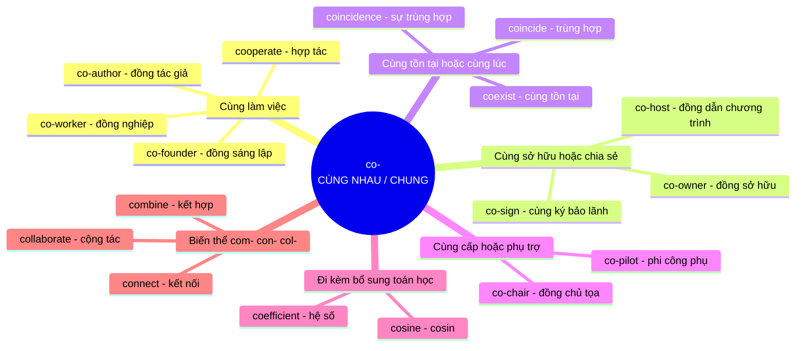

# Ý nghĩa cốt lõi của tiền tố **co-**

**co-** là **tiền tố**, không phải từ đứng một mình (ở dạng viết tắt, **Co.** còn là *Company*, nhưng đó là chuyện khác).

## Khái niệm gốc

**co-** mang ý niệm nền tảng là **CÙNG NHAU / CHUNG**. Nó đến từ tiền tố Latin *com-* (cùng với). Hãy hình dung **hai người cùng cầm một sợi dây**: họ **chia sẻ chung một việc**, không ai làm một mình. Mọi nghĩa còn lại đều là **ẩn dụ mở rộng**: cùng làm, cùng sở hữu, cùng tồn tại, cùng cấp bậc hay đi kèm bổ sung.

### Sơ đồ ý nghĩa cốt lõi

## Giải thích từng nhánh

| Nhóm nghĩa | Hình ảnh ẩn dụ | Ví dụ |
|---|---|---|
| **Cùng làm việc** | Nhiều người **cùng góp sức** vào một công việc | *The two companies agreed to cooperate on the project.* (Hai công ty đồng ý hợp tác trong dự án) |
| **Cùng sở hữu, chia sẻ** | **Chung một phần**, không ai độc chiếm | *She is a co-owner of the restaurant.* (Cô ấy là đồng sở hữu nhà hàng) |
| **Cùng tồn tại, cùng lúc** | Hai thứ **nằm chung một chỗ hoặc một thời điểm** | *The meeting coincided with the holiday.* (Cuộc họp trùng với ngày lễ) |
| **Cùng cấp, phụ trợ** | Hai người **cùng đứng ở một vị trí**, hoặc người thứ hai hỗ trợ người chính | *The co-pilot took over the controls.* (Phi công phụ tiếp quản việc điều khiển) |
| **Đi kèm bổ sung** | Thứ **đi cặp, hoàn thiện** một thứ khác | *cosine* = *complementary sine* (sin của góc phụ) |
| **Biến thể com-, con-, col-** | Cùng gốc **com-**, đổi âm cho dễ đọc trước chữ cái sau | *connect* = *con-* + *nectere* (buộc), nghĩa đen là **buộc chung lại** |

## Mẹo ghi nhớ

Khi gặp từ bắt đầu bằng **co-** lạ, hãy tự hỏi: *"Ai đang cùng ai làm hoặc cùng ở đâu?"*

- **Người + cùng** → **đồng, cùng**: co-worker, co-author
- **Hành động + cùng** → **hợp**: cooperate, collaborate
- **Hai sự việc + cùng lúc** → **trùng, cùng**: coincide, coexist
- **Vị trí + cùng** → **phó, cùng cấp**: co-pilot, co-chair

### So sánh dễ nhầm trong TOEIC

| Từ | Nghĩa | Ví dụ |
|---|---|---|
| **co-worker** | **Đồng nghiệp** cùng công ty, giao tiếp thân mật | *My co-worker helped me with the report.* |
| **colleague** | **Đồng nghiệp**, trang trọng hơn, cũng có thể thuộc công ty khác | *I will ask a colleague from the Seoul office.* |
| **cooperate** | **Hợp tác**, cùng làm theo hướng được yêu cầu | *Please cooperate with the security staff.* |
| **collaborate** | **Cộng tác sáng tạo**, cùng tạo ra một sản phẩm | *They collaborated on a new design.* |

### Lưu ý về cách viết

- Từ mới, ít phổ biến hay gây nhầm thường **có gạch nối**: *co-author*, *co-host*, *co-owner*.
- Từ đã phổ biến thì **viết liền**: *coexist*, *cooperate*, *coincide*, *coworker* (Anh-Mỹ đều chấp nhận *co-worker* và *coworker*).
- Nếu chữ sau bắt đầu bằng **nguyên âm giống nhau** (o), người ta hay dùng gạch nối cho dễ đọc: *co-op* (hợp tác xã), *co-operate* (dạng cổ).

Cách tư duy này giúp bạn **đoán được nghĩa** của rất nhiều từ bắt đầu bằng **co-** mà không cần học thuộc từng từ.