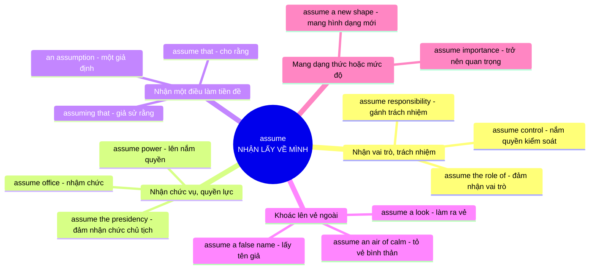

# Ý nghĩa cốt lõi của từ **assume**

## Khái niệm gốc

**assume** mang ý niệm nền tảng là **NHẬN LẤY VỀ MÌNH / GÁNH LẤY**. Từ này gồm *ad-* (hướng về, tới) + *sumere* (cầm lấy, nhận) trong tiếng Latin, nghĩa đen là **cầm một thứ kéo về phía mình, coi nó như của mình**. Đó cũng là lời giải cho cụm **assuming the role of**:

- **assume the role of** = **nhận lấy vai trò của** ai đó → **đảm nhận vai trò**
- **assume that...** = **nhận một điều làm tiền đề** (chưa kiểm chứng) → **cho rằng, giả định**

Hai nghĩa này nghe xa nhau, nhưng thực ra cùng một hành động: **lấy thứ gì đó về phía mình mà không cần ai trao chính thức**.

### Sơ đồ ý nghĩa cốt lõi

## Giải thích từng nhánh

| Nhóm nghĩa | Hình ảnh ẩn dụ | Ví dụ |
|---|---|---|
| **Nhận vai trò, trách nhiệm** | Nghĩa gốc: **kéo một nhiệm vụ về phía mình** và gánh nó | *She assumed the role of team leader after Tom left.* (Cô ấy đảm nhận vai trò trưởng nhóm sau khi Tom rời đi) |
| **Nhận chức vụ, quyền lực** | **Cầm lấy quyền** để chính thức bước vào vị trí | *The new CEO will assume office in January.* (Tân tổng giám đốc sẽ nhậm chức vào tháng Một) |
| **Nhận một điều làm tiền đề** | **Cầm lấy một điều** làm nền để suy nghĩ tiếp, chưa chứng minh | *I assumed you had already seen the email.* (Mình cứ cho là bạn đã xem email rồi) |
| **Khoác lên vẻ ngoài** | **Mặc lên mình** một dáng vẻ như thể nó là của mình | *He assumed a cheerful expression.* (Anh ấy làm ra vẻ vui tươi) |
| **Mang dạng thức, mức độ** | Sự việc **tự nhận lấy** một hình dạng mới | *The issue has assumed great importance.* (Vấn đề đã trở nên rất quan trọng) |

## Họ hàng của gốc **sumere** (cầm lấy)

| Từ | Cấu tạo | Nghĩa đen → nghĩa dùng |
|---|---|---|
| **assume** | *ad-* (tới) + *sumere* | cầm về mình → đảm nhận, cho rằng |
| **consume** | *con-* (hoàn toàn) + *sumere* | lấy hết → tiêu thụ |
| **resume** | *re-* (lại) + *sumere* | cầm lại → tiếp tục |
| **presume** | *prae-* (trước) + *sumere* | cầm trước → cho là, đoán trước |

Nhờ vậy, bạn có thể thấy **sum** trong cả bốn từ đều là **"cầm, lấy"**.

## Mẹo ghi nhớ

Khi gặp **assume** trong một câu lạ, hãy tự hỏi: *"Ai đang nhận lấy cái gì về phía mình?"*

- Nhận **vai trò, nhiệm vụ** → **đảm nhận** (assume the role of)
- Nhận **chức vụ** → **nhậm chức** (assume office)
- Nhận **một điều làm nền tảng** → **cho rằng, giả định** (assume that)
- Nhận **một vẻ ngoài** → **làm ra vẻ** (assume a look)

### So sánh dễ nhầm

| Từ | Nhấn mạnh | Ví dụ |
|---|---|---|
| **assume** | **Nhận về mình**, thường chưa có xác nhận chính thức | *assume responsibility* (nhận trách nhiệm) |
| **adopt** | **Chọn và áp dụng** một cách, một ý tưởng, hoặc nhận nuôi | *adopt a policy* (áp dụng chính sách) |
| **presume** | **Đoán dựa trên khả năng cao**, thiên về suy luận | *I presume you're tired.* (Mình đoán bạn mệt) |
| **take on** | Giống **assume** nghĩa nhận việc, nhưng **thân mật hơn** | *take on a new project* (nhận dự án mới) |

### Lưu ý về cụm **assuming the role of**

- Cấu trúc: **assume the role of + danh từ**, nghĩa là **đảm nhận vai trò của**.
- Ví dụ: ***Assuming the role of** moderator, she kept the discussion on track.* (**Đảm nhận vai trò** người điều phối, cô ấy giữ cho cuộc thảo luận đi đúng hướng.)
- **assuming** đứng đầu câu còn có nghĩa **giả sử rằng**: *Assuming the weather is good, we will leave at noon.* (Giả sử thời tiết tốt, chúng ta sẽ khởi hành vào trưa.)
- Hãy nhìn **từ phía sau** để phân biệt: theo sau là **the role / office / control** thì là **đảm nhận**, theo sau là **một mệnh đề** (that + S + V) thì là **giả sử**.

Cách tư duy này giúp bạn **đoán được nghĩa** của **assume** trong từng ngữ cảnh mà không cần học thuộc từng nghĩa riêng lẻ.