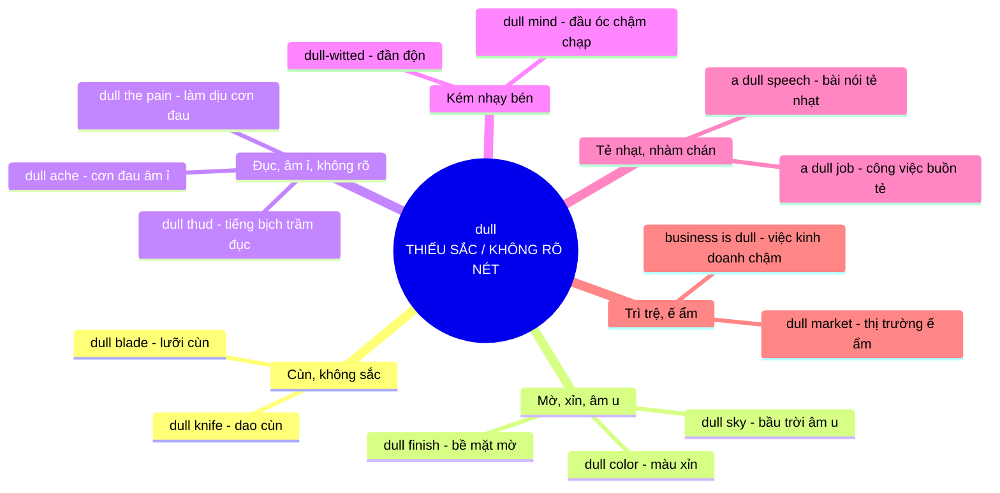

### Khái niệm gốc

**dull** mang ý niệm nền tảng là **THIẾU SẮC / KHÔNG RÕ NÉT**. Hãy hình dung **lưỡi dao bị cùn**: không còn **sắc bén**, không cắt gọn được nữa. Mọi nghĩa còn lại đều là **ẩn dụ mở rộng**: màu thiếu **độ rực** thì xỉn, âm thanh thiếu **độ vang** thì trầm đục, cơn đau thiếu **độ nhói** thì âm ỉ, đầu óc thiếu **độ nhạy** thì chậm chạp, và câu chuyện thiếu **sức hút** thì tẻ nhạt.

#### Sơ đồ ý nghĩa cốt lõi

### Giải thích từng nhánh

|Nhóm nghĩa|Hình ảnh ẩn dụ|Ví dụ|
|---|---|---|
|**Cùn, không sắc**|Nghĩa gốc: lưỡi dao **mất độ sắc**|_This knife is too dull to cut tomatoes._ (Con dao này cùn quá, không cắt được cà chua)|
|**Mờ, xỉn, âm u**|Màu sắc hay ánh sáng **mất độ rực, độ bóng** như lưỡi dao mất độ sáng|_The walls were painted a dull gray._ (Các bức tường được sơn màu xám xỉn)|
|**Đục, âm ỉ**|Âm thanh hay cơn đau **mất độ sắc nét**, chỉ còn lại cảm giác mơ hồ|_I felt a dull pain in my lower back._ (Mình thấy cơn đau âm ỉ ở lưng dưới)|
|**Kém nhạy bén**|Đầu óc **không còn sắc** như lưỡi dao cùn, tiếp thu chậm|_Years of routine had dulled his senses._ (Nhiều năm lặp đi lặp lại làm giác quan của anh ấy trở nên chai lì)|
|**Tẻ nhạt**|Thiếu **điểm sáng** để thu hút, nên người nghe thấy **nhạt nhòa**|_The lecture was long and dull._ (Bài giảng vừa dài vừa tẻ nhạt)|
|**Trì trệ, ế ẩm**|Thị trường **không có sự nhộn nhịp**, mọi thứ lặng lờ|_Sales are dull this month._ (Doanh số tháng này ế ẩm)|

Lưu ý: **dull** còn là **động từ** (_dull the pain_, _dull the edge_) với nghĩa **làm cho cùn, làm giảm bớt**. Danh từ là **dullness**.

### Mẹo ghi nhớ

Khi gặp **dull** trong một câu lạ, hãy tự hỏi: _"Thứ gì đang thiếu độ sắc, độ sáng hay độ nhạy?"_

- Thiếu **độ sắc** của vật → **cùn** (dull knife)
- Thiếu **độ sáng, độ rực** → **xỉn, mờ, âm u** (dull color)
- Thiếu **độ nhói, độ vang** → **âm ỉ, trầm đục** (dull ache)
- Thiếu **độ nhạy** của trí óc → **chậm chạp** (dull mind)
- Thiếu **sức hút** → **tẻ nhạt, nhàm chán** (dull speech)

#### Phân biệt dễ nhầm

|Từ|Nhấn mạnh|Ví dụ|
|---|---|---|
|**dull**|**Thiếu sắc, thiếu sức sống** (rộng nhất)|_a dull day_ (một ngày nhàm chán)|
|**boring**|Gây **chán**, làm người ta muốn bỏ qua|_a boring movie_ (bộ phim chán)|
|**blunt**|**Cùn** về vật lý, hoặc **nói thẳng thừng**|_a blunt pencil_ (bút chì cùn)|
|**dim**|**Mờ, thiếu sáng** (ánh sáng)|_dim light_ (ánh sáng lờ mờ)|

Cách tư duy này giúp bạn **đoán được nghĩa** của **dull** trong từng ngữ cảnh mà không cần học thuộc từng nghĩa riêng lẻ.