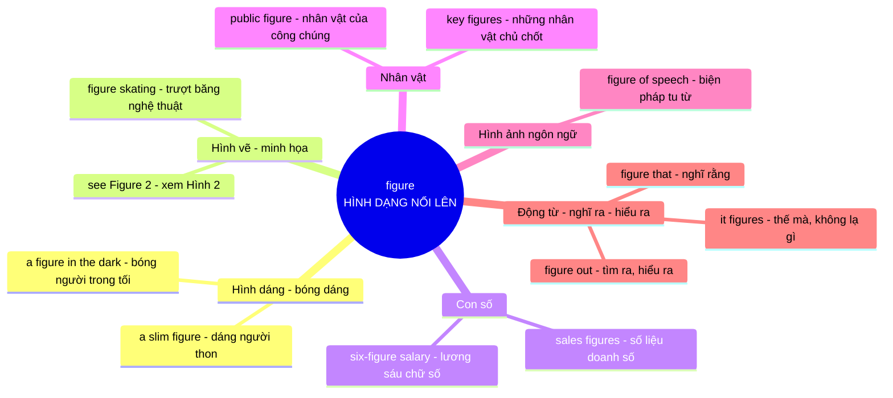

# Ý nghĩa cốt lõi của từ **figure**

## Khái niệm gốc

**figure** (từ Latin *figura*) mang ý niệm nền tảng là **HÌNH DẠNG / ĐƯỜNG NÉT NỔI LÊN**. Đây là lý do một từ nhỏ lại có **nhiều nghĩa phái sinh**, tất cả đều là **ẩn dụ mở rộng** từ việc một thứ gì đó **hiện ra thành hình, rõ nét, nhìn thấy được**: một bóng người trong sương, một con số viết trên giấy, một hình vẽ trong sách. Khi bạn **figure** một điều gì đó, đầu óc bạn cũng đang làm cho nó "hiện hình" rõ ràng.

### Sơ đồ ý nghĩa cốt lõi

---

## Giải thích từng nhánh

| Nhóm nghĩa | Hình ảnh ẩn dụ | Ví dụ |
|---|---|---|
| **Hình dáng** | Nghĩa gốc: **đường nét** của một người hoặc vật hiện ra | *A tall figure stood at the door.* (Một bóng người cao đứng ở cửa) |
| **Hình vẽ** | Đường nét được **vẽ ra giấy** để người đọc nhìn thấy | *See Figure 3 for details.* (Xem Hình 3 để biết chi tiết) |
| **Con số** | Chữ số là **nét viết** có hình dạng cụ thể | *The sales figures look strong.* (Số liệu doanh số trông rất tốt) |
| **Nhân vật** | Một người **nổi bật lên** khỏi đám đông như một hình nổi | *He is a respected public figure.* (Ông là một nhân vật công chúng được kính trọng) |
| **Figure of speech** | Cách nói **tạo hình** cho ý tưởng, ví dụ so sánh, ẩn dụ | *"Time is money" is a figure of speech.* (Đó là một biện pháp tu từ) |
| **Động từ figure** | Làm cho vấn đề **hiện hình rõ trong đầu**: tính ra, nghĩ ra, đoán ra | *I figure we should leave early.* (Mình nghĩ ta nên đi sớm) |

---

# Trường hợp "figures that"

Cụm này có **3 cách hiểu** tùy vai trò của **figures**:

| Vai trò | Nghĩa | Ví dụ |
|---|---|---|
| **Danh từ số nhiều** + that (mệnh đề quan hệ) | **những số liệu / nhân vật mà...** | *These are the **figures that** shocked investors.* (Đây là những **số liệu khiến** nhà đầu tư bàng hoàng) |
| **Động từ** (he/she figures that...) | **nghĩ rằng, cho rằng...** | *She **figures that** the project will finish on time.* (Cô ấy **cho rằng** dự án sẽ xong đúng hạn) |
| **Thành ngữ** *That figures* / *It figures* | **Thế mà, đúng là vậy, chẳng ngạc nhiên** (thường mỉa nhẹ) | *He forgot again? **That figures.*** (Anh ta lại quên à? **Chẳng lạ gì**) |

- Mẹo phân biệt: nếu **figures** đứng sau **the/these/key** thì là **danh từ**. Nếu đứng sau **chủ ngữ (he/she/I)** thì là **động từ** nghĩa "nghĩ rằng".

---

## Mẹo ghi nhớ

Khi gặp **figure** lạ, hãy tự hỏi: *"Cái gì đang hiện hình, ở ngoài đời hay trong đầu?"*
- Hiện hình **ngoài đời** (nhìn thấy được) → dáng người, hình vẽ, con số, nhân vật
- Hiện hình **trong đầu** → nghĩ ra, hiểu ra, cho rằng (*figure out, figure that*)
- Hiện hình **bằng lời nói** → biện pháp tu từ (*figure of speech*)

Cách tư duy này giúp bạn **đoán được nghĩa** mà không cần học thuộc từng cụm.