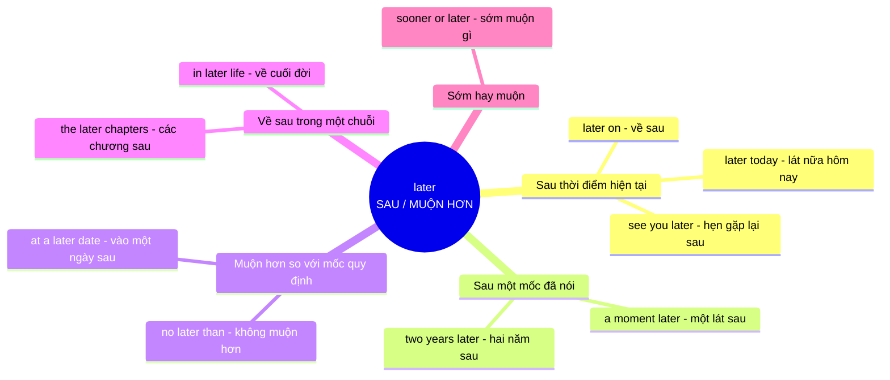

# Ý nghĩa cốt lõi của từ **later**

## Khái niệm gốc

**later** mang ý niệm nền tảng là **SAU / MUỘN HƠN trên trục thời gian**. Đây là dạng so sánh của **late** (tiếng Anh cổ *læt*, nghĩa là **chậm, trễ**), nên **later** = "**muộn hơn** một mốc nào đó". Các nghĩa còn lại đều là **ẩn dụ mở rộng**, chỉ khác nhau ở chỗ **mốc so sánh** là gì: **hiện tại**, một **sự kiện đã nói**, một **hạn chót**, hoặc một **giai đoạn trong chuỗi**.

### Sơ đồ ý nghĩa cốt lõi

## Giải thích từng nhánh

| Nhóm nghĩa | Hình ảnh ẩn dụ | Ví dụ |
|---|---|---|
| **Sau hiện tại** | Mốc so sánh là **bây giờ**, **later** nằm ở phía sau trên trục thời gian | *I'll call you later this evening.* (Tối nay lát nữa mình sẽ gọi bạn) |
| **Sau một mốc đã nói** | Mốc là **sự kiện vừa nhắc**, đo khoảng cách từ đó trở đi | *She moved abroad two years later.* (Hai năm sau cô ấy ra nước ngoài) |
| **Muộn hơn mốc quy định** | Mốc là **hạn chót**, **later than** là vượt qua mốc đó | *Please submit it no later than Friday.* (Vui lòng nộp không muộn hơn thứ Sáu) |
| **Về sau trong chuỗi** | Mốc là **phần đầu** của một chuỗi, **later** là phần nằm cuối | *He wrote his best books in later life.* (Ông viết những cuốn hay nhất khi về già) |
| **Sớm hay muộn** | Đặt **sooner** (sớm hơn) đối lập **later** (muộn hơn), chuyện gì cũng **sẽ đến** | *Sooner or later, the truth will come out.* (Sớm muộn gì sự thật cũng lộ ra) |

## Mẹo ghi nhớ

Khi gặp **later** trong một cụm lạ, hãy tự hỏi: *"Muộn hơn so với mốc nào?"*
- Mốc là **bây giờ** → lát nữa, sau này (later today, see you later)
- Mốc là **một sự kiện đã nhắc** → khoảng thời gian **sau đó** (two years later)
- Mốc là **hạn chót** → **không muộn hơn** (no later than)
- Mốc là **một giai đoạn trong chuỗi** → phần **về sau** (later chapters, later life)

**Lưu ý dễ nhầm:** **later** (**muộn hơn**, chỉ thời gian) khác **latter** (**cái thứ hai** trong hai thứ vừa nhắc), chỉ khác một chữ **t** nhưng nghĩa hoàn toàn khác.

Cách tư duy này giúp bạn **đoán được nghĩa** của **later** ở mọi ngữ cảnh mà không cần học thuộc từng cụm.