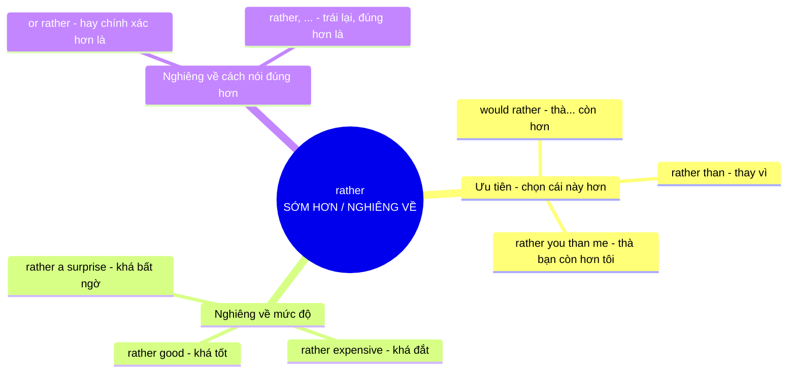

# Ý nghĩa cốt lõi của từ **rather**

## Khái niệm gốc

**rather** mang ý niệm nền tảng là **SỚM HƠN / NGHIÊNG VỀ PHÍA NÀY HƠN**. Từ này vốn là dạng so sánh của từ cổ _rathe_ (**sớm, nhanh**), nên nghĩa gốc là **"sooner"**. Nếu bạn chọn việc nào **sớm hơn, sẵn lòng hơn**, nghĩa là bạn **thiên về** nó hơn. Từ đó sinh ra các nghĩa **ưu tiên**, **mức độ khá** và **đính chính**.

### Sơ đồ ý nghĩa cốt lõi

## Giải thích từng nhánh

|Nhóm nghĩa|Hình ảnh ẩn dụ|Ví dụ|
|---|---|---|
|**Ưu tiên**|Chọn cái **đến sớm hơn, sẵn lòng hơn** trong hai lựa chọn|_I would rather stay home tonight._ (Tối nay mình thà ở nhà hơn)|
|**Thay vì**|**Gạt** lựa chọn kia sang một bên để nghiêng về phía này|_Use email rather than the phone._ (Dùng email thay vì gọi điện)|
|**Mức độ khá**|Cán cân **nghiêng hẳn** về phía tính chất đó, mạnh hơn "một chút"|_The test was rather difficult._ (Bài kiểm tra khá khó)|
|**Đính chính**|**Nghiêng về** cách diễn đạt đúng hơn, rồi sửa lại câu trước|_He's my friend, or rather, my mentor._ (Anh ấy là bạn, hay đúng hơn là người thầy)|
|**Trái lại**|Phủ nhận vế trước để **nghiêng hẳn** sang vế sau|_It isn't cold; rather, it's freezing._ (Không phải lạnh, mà là rét buốt)|

## Mẹo ghi nhớ

Khi gặp **rather**, hãy tự hỏi: _"Cán cân đang nghiêng về phía nào?"_

- Nghiêng giữa **hai hành động** → ưu tiên (**would rather**, **rather than**)
- Nghiêng trên **thang mức độ** → khá, đáng kể (**rather tired**, **rather large**)
- Nghiêng về **cách nói chính xác hơn** → đính chính (**or rather**)

Cách tư duy này giúp bạn **đoán được nghĩa** ở mọi ngữ cảnh mà không cần học thuộc từng cấu trúc. Lưu ý rằng **rather** thường mang sắc thái **hơi bất ngờ hoặc tiêu cực** hơn **quite** (_rather expensive_ nghe như "đắt hơn mình nghĩ").