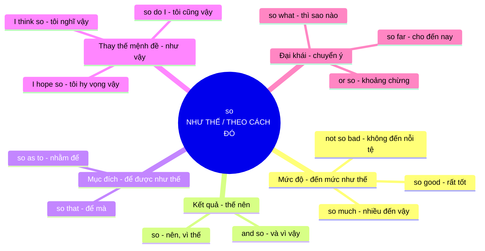

# Ý nghĩa cốt lõi của từ **so**

## Khái niệm gốc

**so** mang ý niệm nền tảng là **NHƯ THẾ / THEO CÁCH ĐÓ**. Từ này đến từ tiếng Anh cổ *swa* (**"theo cách này, như vậy"**), nên bản chất là một từ **chỉ trỏ**: nó **<mark style="background:#affad1">trỏ vào một thứ đã nói hoặc sắp nói</mark>** rồi bảo "như thế đó". Tất cả nghĩa còn lại đều là **ẩn dụ mở rộng**: trỏ vào **mức độ** (đến mức như thế), **kết quả** (thế nên), **mục đích** (để được như thế) hay **cả một mệnh đề** (như vậy).

### Sơ đồ ý nghĩa cốt lõi

## Giải thích từng nhánh

| Nhóm nghĩa | Hình ảnh ẩn dụ | Ví dụ |
|---|---|---|
| **Mức độ** | Chỉ vào **mức như thế**, đến mức cảm thán hoặc so sánh | *This soup is so good.* (Món súp này ngon quá) |
| **Kết quả** | Việc trước **dẫn theo cách đó** đến việc sau, nên "thế nên" | *It rained, so we stayed home.* (Trời mưa nên chúng tôi ở nhà) |
| **Mục đích** | Làm việc A **để mọi thứ được như thế** ở việc B | *Speak slowly so that everyone understands.* (Hãy nói chậm để mọi người hiểu) |
| **Thay thế mệnh đề** | **Một chữ thay cho cả câu** đã nói, tránh lặp lại | *Is he coming? I think so.* (Anh ấy có đến không? Tôi nghĩ là có) |
| **Đại khái / chuyển ý** | Chỉ **khoảng như thế**, hoặc **dẫn sang ý kế tiếp** | *It costs ten dollars or so.* (Giá khoảng mười đô la) |

## Mẹo ghi nhớ

Khi gặp **so** trong một câu lạ, hãy tự hỏi: *"**so** đang trỏ vào cái gì?"*
- Đứng **trước tính từ / trạng từ** → trỏ vào **mức độ** (so tired, so fast)
- Đứng **giữa hai mệnh đề**, vế sau là hệ quả → trỏ vào **kết quả** (so we left)
- Đi với **that / as to** → trỏ vào **mục đích** (so that, so as to)
- Đứng **sau động từ** như think, hope, say, believe → thay cho **cả mệnh đề** (I think so)

Cách tư duy này giúp bạn **đoán được nghĩa** của **so** ở mọi ngữ cảnh mà không cần học thuộc từng cấu trúc.